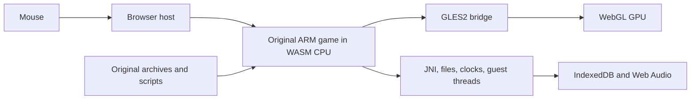

# Original game browser runtime

The preserved target is Android Order Up!! To Go 1.65 (`com.svsgames.orderup`, version code 29). The original ARM32 engine runs locally in desktop Chrome. Its full Burger Face tutorial, first complete Gravy Chug diner shift, encrypted save reload, world map and Mexican kitchen have been exercised with the mouse. Full table service has also passed in Mexican, Italian, Asian and fine-dining kitchens. Pepper Chop and Knife Skills rewards persist across fresh browser reloads; eight Ravioli cuts, boiling, sauce preparation and actual table service have also passed.

## Execution

The original `libOrderUp.so` executes inside a pinned Unicorn ARM emulator compiled from C/C++ to WebAssembly. JavaScript supplies the library's Android-facing JNI, libc, files, synchronization, graphics and audio services. Original CSL/CVM scripts, meshes, animation, shaders, textures, recipes and cooking logic remain original. The game executable and expansion data are never edited.



This is a library compatibility layer, with no Android OS image or server video stream. The iPad executable would be a separate iOS target. Full static translation of all 11,000+ functions has not been attempted. Original CRC, mono ADPCM mixing, font lookup and zlib decompression routines have been reconstructed in C and differentially verified. The mixer, font lookup and decompressor run as targeted C/WASM accelerations inside the emulator.

## Implemented components

- `runtime/elf.mjs`: original ELF segments, ARM relocations, named imports and 84 initializers.
- `runtime/runtime.mjs`, `memory.mjs`: guest heap/stacks, ARM/VFP execution, Thumb interworking, bounded CPU slices and nested native callbacks. Guest pointers remain separate from host pointers. Stable WASM allocations back Unicorn mappings directly, so scalar and buffer access avoids repeated copies. Code writes invalidate the affected translated blocks.
- `runtime/threads.mjs`: original pthread workers, mutexes, semaphores, conditions, sleeping deadlines and cooperative scheduling. Synchronization is implemented rather than reported as unconditional success.
- `runtime/libc.mjs`, `jni.mjs`: actual service contracts used by the game. Unsupported calls raise diagnostic errors. Retired network services report unavailable; original bundled pricing and earned balances remain local.
- `runtime/graphics.mjs`: actual WebGL rendering of original shaders and geometry, including client arrays, mapped vertex buffers, skinning, compressed textures, depth, stencil and blending. The Java wrapper's initial LEQUAL depth state is reproduced. GLES texture name zero is backed by real default WebGL texture objects, preserving GLES upload, parameter and cross-unit sharing semantics. A hidden WebGL canvas is copied to the visible canvas only after a completed native frame, preventing partial drawing during cooperative host yields.
- `runtime/graphics_batch.mjs` and `src/ou_emulator_host.c`: selected void GLES calls are captured in a C/WASM queue and drained before synchronous host calls and CPU yields. Uniform values are copied at capture time. Native font/audio entry hooks call the verified C ports directly; both optimizations retain a switchable baseline for differential tests.
- `runtime/audio.mjs`: stored original Ogg streams, playback completion callbacks, volume/looping and the original 22,050 Hz mono 16-bit PCM mixer. Completed players and JNI references are released; local JNI references expire when each native entry returns.
- `runtime/persistence.mjs`: original encrypted save-file writes/renames/removals committed to IndexedDB and loaded into the guest filesystem on startup. Bionic FILE descriptors and ftruncate support the original decryption pipeline; temporary plaintext files remain transient.
- `web/mouse.mjs`, `web/loop.mjs`: browser pointer capture and scaled original touch coordinates. DOWN and UP reach separate native steps; redundant motion is coalesced. Right-click and Escape reproduce Android Back, including key release across platform dialogs. The original JNI activity-indicator callback drives a nonblocking Loading indicator during scene transitions. Updates target 30 Hz. Tab visibility pauses game time/audio and native execution, then resumes without a time jump.

## Compatibility fixes

The original reopening timer indexes before its duration array when the shutdown type is None (-1). On modern dates, the resulting integer wrap displays a decades-long countdown and stalls the script while formatting it. A native hook returns zero only for None. Real shutdown types execute the untouched ARM routine. See `analysis/timer-compatibility.json`.

Retired ads follow the original ad-unavailable completion callback, allowing menu/day transitions to continue. Original achievements use a browser panel populated with the APK’s own labels. Retired purchases, offers, links and leaderboards show a dismissible message; balances are never granted by these handlers.

## Emulator build and fixes

`tools/build_emulator.py` pins Unicorn.js source `1220477c7fb0f8fe4b500f4bd211de52f6dfe638` and its Unicorn submodule `8028ec436f2d9376525352dd38ed9ed6b9f6be10`. Two source patches free helper-adapter TCG temporaries and end translated blocks before temporary exhaustion. These fixes were required to execute the original constructors reliably.

`src/ou_emulator_host.c` supplies a C/WASM block-budget callback. `uc_emu_start` uses count zero: the pinned engine implements a positive count by installing a costly per-instruction CODE hook. Release compilation uses O3/LTO; `port/build/emulator-build.json` records source revisions, patches, flags, C helper hash and bundle hash. Debug builds remain reproducible with `--debug`. Third-party provenance is in `THIRD_PARTY.md`.

## Evidence and verification scope

| Check | Evidence |
|---|---|
| Original files and all archive formats | Hash-verified APK/OBBs, 112 WAD archives, 21,974 WAD leaf hashes and 3,078 patch files |
| CPU and host ABI | 188 CRC cases, 40 VFP cases, original imported float call, CPU context switching and Thumb returns |
| Constructors and memory | 84 initializers; 173 native-reference writes; 180 memory-helper differential cases |
| Scheduling | Sleeping main, sleeping worker while main busy-polls, actual asset workers; nested guest qsort comparator |
| GPU | 56 recovered shaders compile; original title, 3D chef selection, kitchen and customer render |
| Mouse gameplay | Burger cook/flip/Perfect/plate, lettuce leafing, tomato slicing/Good/plate, fryer lower/cook/raise/plate, bell and first customer served |
| Lifecycle | Fresh-browser native pause/resume and rapid pause/resume requests pass |
| Persistence | Fresh browser reloads the original 125,192-byte encrypted Save00.bin through Continue; 55 earned silver, zero gold and one completed diner day restored |
| Performance | Paired Mexican kitchen: baseline 51.1 ms mean / 17.8 fps; C graphics queue and native font/audio hooks 44.8 ms / 20.1 fps. Busy scenes remain below the 30 fps target. |
| Startup | Sequential cold-profile comparison: original decompression 46.760 s; C/WASM decompression 36.002 s. Loading stages, file count and elapsed time verified |
| Decompression | All 38 original ARM edge cases and 20,039 compressed streams match; 21,974 exact leaf hashes across 112 WAD archives |
| Mini-games | Pepper Chop score 8, original 80-silver reward and return; fresh reload at 318 silver / 3 gold. Knife Skills 10/10 Perfect, original 50 silver and achievement gold |

The long interactive tutorial session received service fixes during testing. Save reload, world map and diner entry use a freshly loaded final runtime. The earlier session alone is not a reproducible full-game proof. See `analysis/original-cooking-session.json`, `runtime-tests.json`, `engine-boot-browser.json`, `status.json`, and `play-*.png`/`fresh-*.png` captures.

The diner end-of-day summary awarded 44 silver (11→55), followed by the original special-guest comment card. Its long session reached about 97,000 frames with 62 live Java objects and a 48.3 MB guest heap high-water mark. Historical WebGL default-texture errors found at scene exit were fixed and independently tested; new kitchen checks show no GL errors. Mexican Guacamole/Chimichangas and two Italian Spaghetti dishes also reached green ticket checks and actual waiter delivery. Asian Vegetable Tempura reached its green completion check. Latest core also completed two Chez Haute Roast Duck dishes (quartering, slicing and oven baking), actual table service, 59 silver native end-of-day income and two achievement gold. Two Kung Fusion sushi dishes also reached complete native flags, actual waiter delivery and 33-silver end-of-day income. A fresh encrypted save restored 214 silver / 3 gold. Italian Pizza was spread, topped with four cheese tosses and sixteen pepperoni tosses, baked for the original 20 seconds, plated and delivered with Spaghetti; the shift earned 24 silver. See `analysis/asian-cooking-verified.json` and `analysis/italian-pizza-mouse-verified.json`. A fully mouse-played Fortified Chef round completed all three dishes and showed the original loss result. Separate, explicitly synthetic fixtures test winning/progression/reward branches; these are never used by the production launcher or user saves. The synthetic tournament fixture completed all three tiers, the original prize wheel and Chef Crown award, return to the world map, and a fresh encrypted-save reload with the crown flag intact. The final-core market session added 5,001 frames with zero guest heap growth and no runtime, graphics or audio errors. Two Chicken Parmesan dishes were dredged with four original actions each, fried, baked, plated and delivered. Crispin Brown prepared an assigned sauce, which was collected through the original food-selection and plate controls. Ravioli completed all eight original cutter actions, boiling and sauce preparation, full plating and actual table service. A fresh browser restored the mid-shift Italian restaurant, 294 silver, 3 gold and the hired assistant. The final 17,532-frame gameplay session ended with 62 Java objects, a 48,298,048-byte guest heap high-water mark and no runtime, graphics or audio errors. This coverage is not an exhaustive unassisted campaign playthrough. The GitHub Pages distribution uses the same runtime, with local APK/OBB selection instead of server-hosted original data.

## Running and reproducing

From the project root, `./port/play.sh` serves the local game at http://127.0.0.1:8147. Start it with the page's Start game button. Keep the same origin/port to retain browser saves.

Useful checks:

```sh
node port/tests/test_runtime.mjs
node port/tests/test_engine_browser.mjs
node port/tests/test_mouse.mjs
node port/tests/test_hot_wasm.mjs
node port/tests/test_decompression_wasm.mjs
node port/tests/test_decompression_assets.mjs
node port/tests/test_graphics_batch.mjs
node port/tests/test_graphics_defaults_browser.mjs
node port/tests/test_loading_browser.mjs
node port/tests/test_platform_browser.mjs
node port/tests/test_save_browser.mjs
node port/tests/test_original_shaders.mjs
```

Historical original-file recovery and archive/C component checks are retained locally in `analysis/local-development-before-github.md`; they are outside the clean source distribution. The root README covers the standalone browser player. Ghidra pseudocode is reference material, not compilable source. Its displayed addresses are ELF addresses plus `0x10000`; `analysis/native-symbols.json` and the runtime use unshifted ELF addresses.

## Claude consultation

Claude and Codex agreed on the library-level WASM compatibility approach after reviewing ARM and original shader probes. Claude independently helped identify the TCG temporary leak and reviewed clock scheduling and tutorial states. A later incorrect suggestion to use instruction counting was corrected against the pinned source and measured 85 ms versus 60 ms kitchen frames; Claude accepted count zero and the block budget. Discussion logs are retained under `analysis/claude-*.json`. Current local evidence takes precedence over earlier speculative assessments.

## GitHub Pages distribution

`node tools/package_pages.mjs` packages the new browser code, compiled emulator, build record, and notices into `_site/`. It uses an explicit file list and never copies original game files or analysis artifacts. Relative web imports support the `/orderup/` project path.

`web/game-files.mjs` accepts the supported APK and two OBB files through the browser file picker, verifies their sizes and SHA-256 hashes, and extracts the ARM library and initial saves from the APK. Optional IndexedDB storage remembers the three files on the player’s computer. Original data is never uploaded. Saves retain the existing runtime format in a separate database. The local server retains automatic file loading and the same local save origin.

`tests/test_game_files.mjs` covers archive parsing and invalid inputs without original data. `tests/test_pages_browser.mjs` uses the local originals to exercise file selection, invalid-selection recovery, remembered-file reload, real engine boot, audio, pointer input, full screen, and project-relative loading. It also checks that the player makes no upload or original-file download requests. Set `OU_PAGES_URL` to run the same test against the published player.
