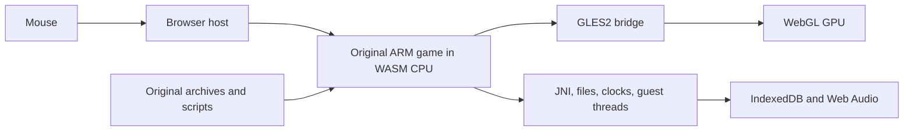

# Original game browser runtime

The preserved target is Android Order Up!! To Go 1.65 (`com.svsgames.orderup`, version code 29). The original ARM32 engine runs locally in desktop Chrome. Its full Burger Face tutorial, first complete Gravy Chug diner shift, encrypted save reload, world map and Mexican kitchen have been exercised with the mouse. Full table service has also passed in Mexican, Italian, Asian and fine-dining kitchens. Pepper Chop and Knife Skills rewards persist across fresh browser reloads; eight Ravioli cuts, boiling, sauce preparation and actual table service have also passed.

## Execution

The original `libOrderUp.so` executes inside a pinned Unicorn ARM emulator compiled from C/C++ to WebAssembly. JavaScript supplies the library's Android-facing JNI, libc, files, synchronization, graphics and audio services. Original CSL/CVM scripts, meshes, animation, shaders, textures, recipes and cooking logic remain original. The game executable and expansion data are never edited.



This is a library compatibility layer, with no Android OS image or server video stream. The iPad executable would be a separate iOS target. Full static translation of all 11,000+ functions has not been attempted. Original CRC, mono ADPCM mixing, font lookup and zlib decompression routines have been reconstructed in C and differentially verified. The mixer, font lookup and decompressor run as targeted C/WASM accelerations inside the emulator.

## Implemented components

- `runtime/elf.mjs`: original ELF segments, ARM relocations, named imports and 84 initializers.
- `runtime/runtime.mjs`, `memory.mjs`: guest heap/stacks, ARM/VFP execution, Thumb interworking, bounded CPU slices and nested native callbacks. Guest pointers remain separate from host pointers. Stable WASM allocations back Unicorn mappings directly, so scalar and buffer access avoids repeated copies. Code writes invalidate the affected translated blocks.
- `runtime/threads.mjs`: original pthread workers, mutexes, semaphores, conditions, sleeping deadlines and cooperative scheduling. Synchronization is implemented rather than reported as unconditional success.
- `runtime/libc.mjs`, `jni.mjs`: actual service contracts used by the game. Unsupported calls raise diagnostic errors. Retired network services report unavailable; original bundled pricing and earned balances remain local.
- `runtime/graphics.mjs`: actual WebGL rendering of original shaders and geometry, including client arrays, mapped vertex buffers, skinning, compressed textures, depth, stencil and blending. The Java wrapper's initial LEQUAL depth state is reproduced. GLES texture name zero is backed by real default WebGL texture objects, preserving GLES upload, parameter and cross-unit sharing semantics. A hidden WebGL canvas is copied to the visible canvas only after a completed native frame, preventing partial drawing during cooperative host yields.
- `runtime/graphics_batch.mjs` and `src/ou_emulator_host.c`: selected void GLES calls are captured in a C/WASM queue and drained before synchronous host calls and CPU yields. Uniform values are copied at capture time. Native font/audio entry hooks call the verified C ports directly; both optimizations retain a switchable baseline for differential tests.
- `runtime/audio.mjs`: stored original Ogg streams, playback completion callbacks, volume/looping and the original 22,050 Hz mono 16-bit PCM mixer. Completed players and JNI references are released; local JNI references expire when each native entry returns. Original PCM is queued with a 200 ms target lead to cover measured completion work, with at most four 50.8 ms blocks mixed per pump. This adds 80 ms of sound-effect headroom over the previous target; stream playback and the game clock remain unchanged. `test_audio_schedule.mjs` checks contiguous sample scheduling through measured stall durations, and full browser challenge runs check for actual scheduling underflows.
- `runtime/persistence.mjs`: original encrypted save-file writes/renames/removals committed to IndexedDB and loaded into the guest filesystem on startup. Bionic FILE descriptors and ftruncate support the original decryption pipeline; temporary plaintext files remain transient.
- `web/mouse.mjs`, `web/loop.mjs`: browser pointer capture and scaled original touch coordinates. DOWN and UP reach separate native steps; redundant motion is coalesced. Right-click and Escape reproduce Android Back, including key release across platform dialogs. The original JNI activity-indicator callback drives a nonblocking Loading indicator during scene transitions. Updates target up to 60 Hz, retaining the original wall-clock game timing. MessageChannel scheduling avoids nested timer clamping; input and native updates remain serialized. Tab visibility pauses game time/audio and native execution, then resumes without a time jump.
- `runtime/fullscreen.mjs`: adds native image/text menu elements beside the world map's Back control, reusing its image, font, shadow and vertical placement. Native setters retain resources and the original menu tree owns destruction. Updates run between guest steps, and element lookup avoids retaining pointers across scene changes. `web/fullscreen.mjs` maps the rendered control's bounds to browser pointer activation, provides keyboard access, and calls the Fullscreen API directly from the user gesture. Escape exits full screen without also sending Android Back. The ordinary browser control appears only when the original main menu is visible; loading, restaurant gameplay, minigames and other screens have no fullscreen overlay. The native world-map control remains available, and Escape can exit fullscreen during gameplay.
- `web/loading.css`: responsive diner-style loading and retry screens, with the original title logo and Manhorn loading-screen artwork. `tools/loading_art.mjs` extracts their WAD entries, decodes the original ETC1 color/alpha textures and exports PNG sprites with transparent margins removed. Packaging generates these assets from the verified OBB release; the local server generates them once in memory. The two sprites total about 193 KB, load before the engine, and require no new dependencies or game binaries in Git. CSS and artwork participate in the player version hash. Download counts, elapsed time, startup phases and automatic launch keep their existing behavior.

## Compatibility fixes

The original reopening timer indexes before its duration array when the shutdown type is None (-1). On modern dates, the resulting integer wrap displays a decades-long countdown and stalls the script while formatting it. A native hook returns zero only for None. Real shutdown types execute the untouched ARM routine. See `analysis/timer-compatibility.json`.

Retired ads follow the original ad-unavailable completion callback, allowing menu/day transitions to continue. Original achievements use a browser panel populated with the APK’s own labels. The original Free Coins button and coin-store dialogs fulfill the original gold-pack and double-silver product IDs locally through the native purchase callback, while the frame controller is paused; no billing service is contacted. Other retired purchases, links and leaderboards show a dismissible message.

## Emulator build and fixes

`tools/build_emulator.py` pins Unicorn.js source `1220477c7fb0f8fe4b500f4bd211de52f6dfe638` and its Unicorn submodule `8028ec436f2d9376525352dd38ed9ed6b9f6be10`. Seven source patches free helper-adapter TCG temporaries, end translated blocks before temporary exhaustion, integrate bounded host yielding into existing TCI block-entry checks, cache direct RAM-region lookup with invalidation on mapping changes, speed up public reads of ordinary RAM, specialize the existing block-entry exit check, and expose optional interpreter assertions. The first two fixes allow the original constructors to execute reliably. The direct-read guard excludes snapshots, MMIO, nested or disabled regions, subpages and boundary crossings; writes retain the original address-space write for code invalidation and dirty tracking.

`src/ou_emulator_host.c` supplies the C/WASM host budget interface. Release builds use the existing translator block-entry check, with count zero and no global per-block JavaScript hook. `uc_emu_start` uses count zero: the pinned engine implements a positive count by installing a costly per-instruction CODE hook. Release compilation uses O3/LTO; `port/build/emulator-build.json` records source revisions, patches, flags, the C source hashes and the bundle hash. The specialized entry check retains the same original helper, PC synchronization, optimizer/global-state contract, host-budget checks and stop requests. It removes the generic twelve-word helper argument setup. Twenty-five independent native ARM/Thumb programs verify chained-block stops, instruction counts, conditional faults, memory protection, cross-page faults and undefined instructions, including exact CPU state and callback order. Debug builds remain reproducible with `--debug`; add `--interpreter-assertions` for bytecode operand-size and register assertions. `--no-fast-exit` retains the generic entry path for comparison. Third-party provenance is in `THIRD_PARTY.md`.

## Evidence and verification scope

| Check | Evidence |
|---|---|
| Original files and all archive formats | Hash-verified APK/OBBs, 112 WAD archives, 21,974 WAD leaf hashes and 3,078 patch files |
| CPU and host ABI | 188 CRC cases, 40 VFP cases, original imported float call, CPU context switching and Thumb returns |
| Constructors and memory | 84 initializers; 173 native-reference writes; 180 memory-helper differential cases |
| Scheduling | Sleeping main, sleeping worker while main busy-polls, actual asset workers; nested guest qsort comparator |
| GPU | 56 recovered shaders compile; original title, 3D chef selection, kitchen and customer render |
| Mouse gameplay | Burger cook/flip/Perfect/plate, lettuce leafing, tomato slicing/Good/plate, fryer lower/cook/raise/plate, bell and first customer served |
| Lifecycle | Fresh-browser native pause/resume and rapid pause/resume requests pass |
| Persistence | Fresh browser reloads the original 125,192-byte encrypted Save00.bin through Continue; 55 earned silver, zero gold and one completed diner day restored |
| Performance | All five kitchens, eight complete mouse challenge rounds, a mouse-cooked meal with original customer receipt, and two tournament demonstration/handoff runs meet a measured displayed one-second minimum of at least 30 fps. See the exact release matrix below; short hitches remain. |
| Startup | Optimized release reaches the menu in about 6 seconds on this Mac once the data is available, compared with about 37 seconds before this performance update. Loading stages, file count and elapsed time verified; first-time network download is additional. |
| Decompression | All 38 original ARM edge cases and 20,039 compressed streams match; 21,974 exact leaf hashes across 112 WAD archives |
| Mini-games | Pepper Chop score 8, original 80-silver reward and return; fresh reload at 318 silver / 3 gold. Knife Skills 10/10 Perfect, original 50 silver and achievement gold |

The long interactive tutorial session received service fixes during testing. Save reload, world map and diner entry use a freshly loaded final runtime. The earlier session alone is not a reproducible full-game proof. See `analysis/original-cooking-session.json`, `runtime-tests.json`, `engine-boot-browser.json`, `status.json`, and `play-*.png`/`fresh-*.png` captures.

The diner end-of-day summary awarded 44 silver (11→55), followed by the original special-guest comment card. Its long session reached about 97,000 frames with 62 live Java objects and a 48.3 MB guest heap high-water mark. Historical WebGL default-texture errors found at scene exit were fixed and independently tested; new kitchen checks show no GL errors. Mexican Guacamole/Chimichangas and two Italian Spaghetti dishes also reached green ticket checks and actual waiter delivery. Asian Vegetable Tempura reached its green completion check. Latest core also completed two Chez Haute Roast Duck dishes (quartering, slicing and oven baking), actual table service, 59 silver native end-of-day income and two achievement gold. Two Kung Fusion sushi dishes also reached complete native flags, actual waiter delivery and 33-silver end-of-day income. A fresh encrypted save restored 214 silver / 3 gold. Italian Pizza was spread, topped with four cheese tosses and sixteen pepperoni tosses, baked for the original 20 seconds, plated and delivered with Spaghetti; the shift earned 24 silver. See `analysis/asian-cooking-verified.json` and `analysis/italian-pizza-mouse-verified.json`. A fully mouse-played Fortified Chef round completed all three dishes and showed the original loss result. Separate, explicitly synthetic fixtures test winning/progression/reward branches; these are never used by the production launcher or user saves. The synthetic tournament fixture completed all three tiers, the original prize wheel and Chef Crown award, return to the world map, and a fresh encrypted-save reload with the crown flag intact. The final-core market session added 5,001 frames with zero guest heap growth and no runtime, graphics or audio errors. Two Chicken Parmesan dishes were dredged with four original actions each, fried, baked, plated and delivered. Crispin Brown prepared an assigned sauce, which was collected through the original food-selection and plate controls. Ravioli completed all eight original cutter actions, boiling and sauce preparation, full plating and actual table service. A fresh browser restored the mid-shift Italian restaurant, 294 silver, 3 gold and the hired assistant. The final 17,532-frame gameplay session ended with 62 Java objects, a 48,298,048-byte guest heap high-water mark and no runtime, graphics or audio errors. This coverage is not an exhaustive unassisted campaign playthrough. The GitHub Pages distribution uses the same runtime and automatically downloads its required data from the hosted build.

## Running and reproducing

The browser shows a single **Skip Tutorial** button only while the original Burger Face tutorial is active. `web/tutorial.mjs` queues a click for the frame loop and remembers a successful skip in the browser's `orderup-skip-tutorial` localStorage key. There is no tutorial toggle or preference panel. `runtime/tutorial.mjs` recognizes the original tutorial FSM and uses native state transitions, temporary-assistant setup/cleanup, and the original end-of-day/save path. Tutorial-owned native timers are cancelled before scene teardown so delayed dialogue cannot notify a destroyed FSM. No prepared save or patched game asset is used. The remembered choice is local to the browser/origin, just like the existing saves.

`node port/tests/test_tutorial.mjs` checks visibility, a single skip per click, input release, remembered choices, and serialized click handling. `node port/tests/test_tutorial_browser.mjs` exercises the button's label and visibility, fresh-player skipping, original encrypted-save reload, and automatic skipping on the next new game. It requires the same local assets, Chrome, Playwright, and OCR helper as the other gameplay tests. Reports and screenshots go to `analysis/`.

From the project root, `./port/play.sh` serves the local game at http://127.0.0.1:8147. It starts automatically after loading and preparation. Keep the same origin/port to retain browser saves.

Useful checks:

```sh
node port/tests/test_runtime.mjs
node port/tests/test_mapping_cache_wasm.mjs
python3 tools/test_ram_api.py
node port/tests/test_script_marks_wasm.mjs
node port/tests/test_engine_browser.mjs
node port/tests/test_mouse.mjs
node port/tests/test_fullscreen.mjs
node port/tests/test_fullscreen_browser.mjs
node port/tests/test_hot_wasm.mjs
node port/tests/test_decompression_wasm.mjs
node port/tests/test_decompression_assets.mjs
node port/tests/test_graphics_batch.mjs
node port/tests/test_graphics_defaults_browser.mjs
node port/tests/test_loading_browser.mjs
node port/tests/test_platform_browser.mjs
node port/tests/test_save_browser.mjs
node port/tests/test_original_shaders.mjs
```

Historical original-file recovery and archive/C component checks are retained locally in `analysis/local-development-before-github.md`; they are outside the clean source distribution. The root README covers the standalone browser player. Ghidra pseudocode is reference material, not compilable source. Its displayed addresses are ELF addresses plus `0x10000`; `analysis/native-symbols.json` and the runtime use unshifted ELF addresses.

## Claude consultation

Claude and Codex agreed on the library-level WASM compatibility approach after reviewing ARM and original shader probes. Claude independently helped identify the TCG temporary leak and reviewed clock scheduling and tutorial states. A later incorrect suggestion to use instruction counting was corrected against the pinned source and measured 85 ms versus 60 ms kitchen frames; Claude accepted count zero and the block budget. Discussion logs are retained under `analysis/claude-*.json`. Current local evidence takes precedence over earlier speculative assessments. For this performance update, Claude reviewed generic collector continuation, floating-point upload, heap release and direct-RAM invariants. Reviews used no private game source or assets. The final review covered the block-entry global/liveness and stop/fault contract, all 55 release and assertion groups, and the full scene matrix. After clarifying that graphics-error queries are guest-observable and decompression already uses the verified native decoder, Claude agreed to retain both and publish only the measured one-second-floor claim with preparation hitches and PCM gaps disclosed. The remaining burst is resource preparation rather than a native collector fault: a separate profiled run loads 160 textures, 192 buffers and 359 decompression calls, with no native-GC phase work or audio decoding; the profile itself is not used as FPS evidence. Direct memory access preserves MMIO and snapshot paths, and original ARM differential fixtures remain the acceptance check.

## GitHub Pages distribution

The browser port uses the original ARM engine in WebAssembly; decompilation supplied reference information, not a complete recompilable game source tree.

The `game-data-1.65` release supplies the exact seven runtime-data files in `game-data.json`: the ARM library, original APK and expansion archives, original initial game data, and achievement labels. The data stays outside source history and excludes personal saves, unrelated downloads, and analysis artifacts. `tools/package_game_data.py` verifies sizes and SHA-256 hashes when creating or extracting the release.

`node tools/package_pages.mjs` assembles the browser code, emulator, notices, and verified runtime data into `_site/`. The Pages workflow retrieves the release before packaging. `web/downloads.mjs` fetches and verifies each game file automatically using project-relative URLs. Download progress measures decoded bytes from the manifest, so HTTP gzip does not break progress or size checks. There is no file picker. Every packaged module and the engine share a content-derived version query, so returning players receive one coherent build instead of a mixture of old cached code. `build.json` identifies the version and engine hash. Existing browser saves keep their original format and database.

`tests/test_downloads.mjs` checks automatic downloads, project-relative paths, gzip handling, integrity checks, and missing/truncated/oversized file failures with small synthetic payloads. `tests/test_pages_browser.mjs` starts the complete player in a fresh browser without local game files and verifies engine boot, audio, full screen, mouse input, automatic data loading, and the loading artwork and stylesheet. Set `OU_PAGES_URL` to run the same test against the published site.

## Performance C ports

The original Variant/container marking, function/module/module-bank marking, bank scans and complete garbage-collection traversal retain callback and mutation order through guest continuations. Original object callbacks remain in control of destruction. Ordinary heap allocation, release and free-block coalescing now run in C, including fragmented lists, alignment, released-memory poison, handle links and allocation counters; foreign allocator and diagnostic paths execute the original ARM code. Rendering ports cover the original texture/camera lookups, uniform comparisons and uploads, vector constants, material lookup and order-table queues. Additional ports cover signed-byte string comparison, seeded checksums, menu dirty/name traversal, graphics state caching, Variant equality and associative lookup. Integer/float comparisons preserve all four ARM rounding modes and FP controls, and nested guest callbacks inherit the caller’s FPSCR. They preserve 960×640 rendering, shaders, geometry, audio and mouse input.

Additional C/WASM ports cover full font layout and glyph assembly, encrypted-save block chains and digests, script values and table operations, region selection and handle references, skeletal animation, and dynamic mesh updates. The bytecode decoder transfers control back to the original opcode handlers and preserves their exception and deadline checks. Material batching skips only unchanged zero-texture bindings; callbacks and changed or foreign bindings resume the original ARM path. Long region searches fall back before changing arguments or links.

Float imports use the same JavaScript Math operations and float32 ABI as the existing host implementation, called directly from the WASM acceleration. Nonfinite inputs and results retain the host fallback. This removes repeated emulator exits for trigonometry without substituting a different math library. Equivalence checks include signed zero, subnormals, NaN payloads, every floating-point control mode, ARM/Thumb callers, live import bindings, and enable/disable switching.

Resource ports reproduce the original texture/material searches, unsigned WAD index probes, and byte-at-a-time XPL string loops. The WAD port checks both the comparator code and the live relocated callback literal; changed bindings resume the original ARM path. String copying retains forward overlap behavior and the original extra NUL write, including zero/one-byte limits. Bounded searches and stack-alias guards fall back before mutation. Full-register, flags, floating-point state, stack, output-memory and Thumb-caller comparisons cover more than 9,600 cases across these five functions.

Memory-range insertion/removal retain stable ordering, exact 12-byte shifts, wrapped ends, raw 16-bit flags and original stack writes. Full tables, unaligned objects and stack aliases use the original ARM path. Hash-index folding retains every defined original width, including zero and 32, unsigned keys, shifts, flags and callee stack writes; undefined widths fall back. Together these helpers pass more than 19,000 original/accelerated/fallback comparisons.

Sleeping workers keep their original wake deadlines. A real semaphore or mutex grant can prioritize a previously blocked worker at a legal scheduling boundary; ordinary round-robin scheduling still advances, and fairness, locked-mutex and sleeper tests cover that handoff. Translation preparation compiles observed valid entry blocks while idle without executing guest instructions. Save streams grow geometrically while retaining exact logical lengths, sparse zeros and immutable committed snapshots.

Knife sharpening exposes a mouse-operated Tilt slider, and Asleep on the Job exposes a Shake button. Both feed the original motion-input handlers and retain their original scoring and timers. The motion adapter restores device state when the game stops consuming it; differential tests cover the original handlers, their stacks, callback arguments and motion expiry. These controls reserve space beneath the canvas only while needed.

Independent untouched ARM runs supply memory and callback reference fixtures. New equivalence checks include 192 uniform checks, 224 container-cleanup checks, 720 render-loop checks, 768 heap-release checks, 6,912 allocation checks, 4,992 string/menu checks, 1,536 render-state checks, 37,632 equality/associative-lookup checks and 1,152 function/module/module-bank checks, alongside original CPU/VFP, memory mapping, scheduler, graph marking and collection tests. A real cooking timer advanced 8.026 seconds in 8.026 seconds of wall time. Raw memory tests also verify protected RAM, cross-region failure atomicity, MMIO callbacks, externally backed RAM and snapshot copy-on-write. Experimental binaries and performance controls remain under analysis/testing paths; the production player imports no QA fixtures. Full-frame interval outliers are reported rather than hidden by average FPS.


## Release performance verification

Measured on 5 November 2026 with Chrome 156 / ANGLE Metal on an Apple M5 Max. The browser viewport is full screen at 1920×1080; original game rendering remains 960×640 and original audio is enabled. Builds, profilers and other QA game browsers are idle during these runs.

Average fps counts completed native updates. Displayed minimum independently counts unique completed canvas copies observed by requestAnimationFrame in continuous one-second windows, immediately before a completion and excluding the next frame. Native JNI loading swaps are counted separately rather than credited as additional updates. Each run excludes only its first 60 warmup frames; later preparation, gameplay and result-transition outliers remain included. The cooking audit and both tournament routes confirm no additional game updates.

| Scene | Native frames | Average native fps | Minimum displayed in one second | Longest work interval (ms) |
|---|---:|---:|---:|---:|
| Gravy Chug diner, two orders | 2,340 | 59.34 | 48 | 36.5 |
| Stuffolini, hired assistant, two orders | 2,340 | 59.12 | 49 | 26.1 |
| Kung Fusion, three orders | 2,340 | 59.50 | 46 | 33.5 |
| Chez Haute, four orders | 2,340 | 59.07 | 45 | 36.6 |
| El Fuego, five orders | 2,341 | 48.30 | 45 | 54.0 |
| Newsboy Nosedive | 5,340 | 53.56 | 34 | 134.1 |
| Dish Washer | 4,141 | 38.74 | 34 | 136.6 |
| Kitchen Fire | 3,541 | 53.19 | 36 | 166.7 |
| Rats | 4,141 | 44.77 | 32 | 145.0 |
| Asleep on the Job | 3,541 | 57.70 | 53 | 65.2 |
| Knife Sharpening | 3,540 | 59.27 | 47 | 44.3 |
| Pepper Chop | 4,141 | 47.23 | 41 | 82.2 |
| Knife Skills | 4,140 | 59.31 | 42 | 55.5 |
| Three-part macaroni and cheese, original waiter delivery | 8,941 | 56.63 | 41 | 272.3 |
| Fortified Chef rules, preparation, opponent demo and player handoff | 5,341 | 57.15 | 35 | 394.1 |
| Fortified Chef full route, fresh repeat | 5,341 | 57.20 | 34 | 391.9 |

Every measured route has a displayed one-second minimum of at least 32 fps on this machine. These are one-second floors: they do not mean every individual frame finishes within 33.3 ms. Tournament preparation still reaches about 394 ms in one native update, with about 392 ms in the fresh repeat. First use of the cooking tool reaches about 272 ms. These hitches remain visible in the raw histories. Each tournament run has one original PCM scheduling underflow (about 161 and 188 ms), and the first-tool cooking run has one about 59 ms underflow. All five kitchen runs and all eight challenge rounds have no recorded PCM underflows. No runtime, WebGL or audio-decoding errors occurred in the measured routes.

The complete three-part macaroni-and-cheese meal was cooked, grated, combined and plated with real mouse input. Read-only observations of the original Order::Instance::InitScoringData and matching Customer::Instance::RecieveMeal calls prove actual waiter delivery, alongside all three original prepared/plated flags. The five-order Mexican kitchen uses original earned balances and normal menu stocking. Rare challenge setup enters the original event scripts; it does not change scores, timers, prepared/plated flags or opponent times.

Rebuilding the final release changed only its embedded debug module filename; every executable WASM section and the surrounding JavaScript are identical to the frozen performance candidate. All 55 semantic/runtime groups pass on the frozen release engine; all 55 also pass with interpreter operand/register assertions, host assertions and stack checks. The compact standalone ARM/Thumb CPU fixture additionally passes on the unchanged generic-entry baseline. Loading, full-screen input, original encrypted-save reload, actual guest sleep deadlines, lifecycle and tutorial controls have separate browser checks. The complete source, scene measurements and exact engine hash are summarized in [performance.json](performance.json); local raw reports and screenshots use the analysis/performance-fast-exit prefix and are excluded from the hosted player.

This covers all five kitchen types, all eight active mobile challenge rounds, cooking/service, and two complete tournament demonstration/player-handoff routes. Earlier functional coverage includes end-of-day screens and tournament reward branches. An exhaustive unassisted campaign, every recipe combination, other computers, other browser engines, and battery or thermal states are not certified. Original-iPad performance parity has not been measured. Startup is about six seconds after the game data is available; the first approximately 187 MB download adds connection-dependent time.

Game assets use the `orderup-game-assets-v1` Cache Storage cache, keyed by project URL and manifest SHA-256, independently of player build versions and encrypted saves. Cached bytes are verified before use; changed, missing, or corrupt files are downloaded and verified before caching. Cache denial/quota errors fall back to normal downloads. The small manifest is revalidated on each visit. Startup never waits for autoplay permission: sound is unlocked by the first interaction, and the progress bar reserves completion for the first game frame. `test_downloads.mjs` covers cache failure/update paths; `test_cache_browser.mjs` checks cold/warm startup across browser restarts with HTTP caching disabled. `test_cache_webkit.mjs` repeats the persistent-profile check in WebKit; `OU_WEBKIT_PATH` can select an installed WebKit executable.
