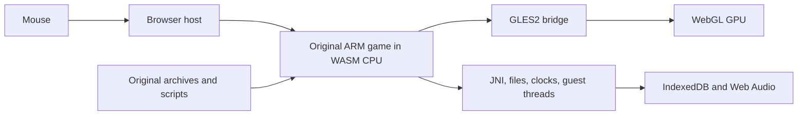

# Original game browser runtime

The preserved target is Android Order Up!! To Go 1.65 (`com.svsgames.orderup`, version code 29). The original ARM32 engine runs locally in desktop Chrome. Its full Burger Face tutorial, first complete Gravy Chug diner shift, encrypted save reload, world map and Mexican kitchen have been exercised with the mouse. Full table service has also passed in Mexican, Italian, Asian and fine-dining kitchens. Pepper Chop and Knife Skills rewards persist across fresh browser reloads; eight Ravioli cuts, boiling, sauce preparation and actual table service have also passed.

## Execution

The original `libOrderUp.so` executes inside a pinned Unicorn ARM emulator compiled from C/C++ to WebAssembly. JavaScript supplies the library's Android-facing JNI, libc, files, synchronization, graphics and audio services. Original CSL/CVM scripts, meshes, animation, shaders, textures, recipes and cooking logic remain original. The game executable and expansion data are never edited.



This is a library compatibility layer, with no Android OS image or server video stream. The iPad executable would be a separate iOS target. Full static translation of all 11,000+ functions has not been attempted. Original CRC, mono ADPCM mixing, font lookup and zlib decompression routines have been reconstructed in C and differentially verified. The mixer, font lookup and decompressor run as targeted C/WASM accelerations inside the emulator.

## Implemented components

- `runtime/elf.mjs`: original ELF segments, ARM relocations, named imports and 84 initializers.
- `runtime/runtime.mjs`, `memory.mjs`: guest heap/stacks, ARM/VFP execution, Thumb interworking, bounded CPU slices and nested native callbacks. Guest pointers remain separate from host pointers. Stable WASM allocations back Unicorn mappings directly, so scalar and buffer access avoids repeated copies. Code writes invalidate the affected translated blocks.
- `runtime/threads.mjs`: original pthread workers, mutexes, semaphores, conditions, sleeping deadlines and cooperative scheduling. Synchronization is implemented rather than reported as unconditional success.
- `runtime/libc.mjs`, `jni.mjs`: actual service contracts used by the game. Unsupported calls raise diagnostic errors. Retired network services report unavailable; original bundled pricing and earned balances remain local.
- `runtime/graphics.mjs`: actual WebGL rendering of original shaders and geometry, including client arrays, mapped vertex buffers, skinning, compressed textures, depth, stencil and blending. The Java wrapper's initial LEQUAL depth state is reproduced. GLES texture name zero is backed by real default WebGL texture objects, preserving GLES upload, parameter and cross-unit sharing semantics. A hidden WebGL canvas is copied to the visible canvas only after a completed native frame, preventing partial drawing during cooperative host yields.
- `runtime/graphics_batch.mjs` and `src/ou_emulator_host.c`: selected void GLES calls are captured in a C/WASM queue and drained before synchronous host calls and CPU yields. Uniform values are copied at capture time. Native font/audio entry hooks call the verified C ports directly; both optimizations retain a switchable baseline for differential tests.
- `runtime/audio.mjs`: stored original Ogg streams, playback completion callbacks, volume/looping and the original 22,050 Hz mono 16-bit PCM mixer. Completed players and JNI references are released; local JNI references expire when each native entry returns.
- `runtime/persistence.mjs`: original encrypted save-file writes/renames/removals committed to IndexedDB and loaded into the guest filesystem on startup. Bionic FILE descriptors and ftruncate support the original decryption pipeline; temporary plaintext files remain transient.
- `web/mouse.mjs`, `web/loop.mjs`: browser pointer capture and scaled original touch coordinates. DOWN and UP reach separate native steps; redundant motion is coalesced. Right-click and Escape reproduce Android Back, including key release across platform dialogs. The original JNI activity-indicator callback drives a nonblocking Loading indicator during scene transitions. Updates target up to 60 Hz, retaining the original wall-clock game timing. MessageChannel scheduling avoids nested timer clamping; input and native updates remain serialized. Tab visibility pauses game time/audio and native execution, then resumes without a time jump.

## Compatibility fixes

The original reopening timer indexes before its duration array when the shutdown type is None (-1). On modern dates, the resulting integer wrap displays a decades-long countdown and stalls the script while formatting it. A native hook returns zero only for None. Real shutdown types execute the untouched ARM routine. See `analysis/timer-compatibility.json`.

Retired ads follow the original ad-unavailable completion callback, allowing menu/day transitions to continue. Original achievements use a browser panel populated with the APK’s own labels. The original Free Coins button and coin-store dialogs fulfill the original gold-pack and double-silver product IDs locally through the native purchase callback, while the frame controller is paused; no billing service is contacted. Other retired purchases, links and leaderboards show a dismissible message.

## Emulator build and fixes

`tools/build_emulator.py` pins Unicorn.js source `1220477c7fb0f8fe4b500f4bd211de52f6dfe638` and its Unicorn submodule `8028ec436f2d9376525352dd38ed9ed6b9f6be10`. Five source patches free helper-adapter TCG temporaries, end translated blocks before temporary exhaustion, integrate bounded host yielding into existing TCI block-entry checks, cache direct RAM-region lookup with invalidation on mapping changes, and speed up public reads of ordinary RAM. The first two fixes allow the original constructors to execute reliably. The direct-read guard excludes snapshots, MMIO, nested or disabled regions, subpages and boundary crossings; writes retain the original address-space write for code invalidation and dirty tracking.

`src/ou_emulator_host.c` supplies the C/WASM host budget interface. Release builds use the existing translator block-entry check, with count zero and no global per-block JavaScript hook. `uc_emu_start` uses count zero: the pinned engine implements a positive count by installing a costly per-instruction CODE hook. Release compilation uses O3/LTO; `port/build/emulator-build.json` records source revisions, patches, flags, all eight C source hashes and the bundle hash. Debug builds remain reproducible with `--debug`. Third-party provenance is in `THIRD_PARTY.md`.

## Evidence and verification scope

| Check | Evidence |
|---|---|
| Original files and all archive formats | Hash-verified APK/OBBs, 112 WAD archives, 21,974 WAD leaf hashes and 3,078 patch files |
| CPU and host ABI | 188 CRC cases, 40 VFP cases, original imported float call, CPU context switching and Thumb returns |
| Constructors and memory | 84 initializers; 173 native-reference writes; 180 memory-helper differential cases |
| Scheduling | Sleeping main, sleeping worker while main busy-polls, actual asset workers; nested guest qsort comparator |
| GPU | 56 recovered shaders compile; original title, 3D chef selection, kitchen and customer render |
| Mouse gameplay | Burger cook/flip/Perfect/plate, lettuce leafing, tomato slicing/Good/plate, fryer lower/cook/raise/plate, bell and first customer served |
| Lifecycle | Fresh-browser native pause/resume and rapid pause/resume requests pass |
| Persistence | Fresh browser reloads the original 125,192-byte encrypted Save00.bin through Continue; 55 earned silver, zero gold and one completed diner day restored |
| Performance | Release checks use completed native frames and conservative continuous one-second windows. Busy Mexican kitchen: 37.69 fps average / minimum 35; Italian with an assistant: 44.67 / 43; fine dining: 42.43 / 40; Asian: 48.89 / 46; diner: 41.73 / 40. Full tournament demonstration and handoff: 47.98 / 31, including a 127.3 ms asset-loading interval. No sound gaps or runtime/graphics errors in these runs. Chrome/ANGLE/Metal on the development M5 Max. See release verification below for the final scene matrix and repeat. |
| Startup | Optimized release reaches the menu in about 10–11 seconds on this Mac once the data is available, compared with about 37 seconds before this performance update. Loading stages, file count and elapsed time verified; first-time network download is additional. |
| Decompression | All 38 original ARM edge cases and 20,039 compressed streams match; 21,974 exact leaf hashes across 112 WAD archives |
| Mini-games | Pepper Chop score 8, original 80-silver reward and return; fresh reload at 318 silver / 3 gold. Knife Skills 10/10 Perfect, original 50 silver and achievement gold |

The long interactive tutorial session received service fixes during testing. Save reload, world map and diner entry use a freshly loaded final runtime. The earlier session alone is not a reproducible full-game proof. See `analysis/original-cooking-session.json`, `runtime-tests.json`, `engine-boot-browser.json`, `status.json`, and `play-*.png`/`fresh-*.png` captures.

The diner end-of-day summary awarded 44 silver (11→55), followed by the original special-guest comment card. Its long session reached about 97,000 frames with 62 live Java objects and a 48.3 MB guest heap high-water mark. Historical WebGL default-texture errors found at scene exit were fixed and independently tested; new kitchen checks show no GL errors. Mexican Guacamole/Chimichangas and two Italian Spaghetti dishes also reached green ticket checks and actual waiter delivery. Asian Vegetable Tempura reached its green completion check. Latest core also completed two Chez Haute Roast Duck dishes (quartering, slicing and oven baking), actual table service, 59 silver native end-of-day income and two achievement gold. Two Kung Fusion sushi dishes also reached complete native flags, actual waiter delivery and 33-silver end-of-day income. A fresh encrypted save restored 214 silver / 3 gold. Italian Pizza was spread, topped with four cheese tosses and sixteen pepperoni tosses, baked for the original 20 seconds, plated and delivered with Spaghetti; the shift earned 24 silver. See `analysis/asian-cooking-verified.json` and `analysis/italian-pizza-mouse-verified.json`. A fully mouse-played Fortified Chef round completed all three dishes and showed the original loss result. Separate, explicitly synthetic fixtures test winning/progression/reward branches; these are never used by the production launcher or user saves. The synthetic tournament fixture completed all three tiers, the original prize wheel and Chef Crown award, return to the world map, and a fresh encrypted-save reload with the crown flag intact. The final-core market session added 5,001 frames with zero guest heap growth and no runtime, graphics or audio errors. Two Chicken Parmesan dishes were dredged with four original actions each, fried, baked, plated and delivered. Crispin Brown prepared an assigned sauce, which was collected through the original food-selection and plate controls. Ravioli completed all eight original cutter actions, boiling and sauce preparation, full plating and actual table service. A fresh browser restored the mid-shift Italian restaurant, 294 silver, 3 gold and the hired assistant. The final 17,532-frame gameplay session ended with 62 Java objects, a 48,298,048-byte guest heap high-water mark and no runtime, graphics or audio errors. This coverage is not an exhaustive unassisted campaign playthrough. The GitHub Pages distribution uses the same runtime and automatically downloads its required data from the hosted build.

## Running and reproducing

From the project root, `./port/play.sh` serves the local game at http://127.0.0.1:8147. It starts automatically after loading and preparation. Keep the same origin/port to retain browser saves.

Useful checks:

```sh
node port/tests/test_runtime.mjs
node port/tests/test_mapping_cache_wasm.mjs
python3 tools/test_ram_api.py
node port/tests/test_script_marks_wasm.mjs
node port/tests/test_engine_browser.mjs
node port/tests/test_mouse.mjs
node port/tests/test_hot_wasm.mjs
node port/tests/test_decompression_wasm.mjs
node port/tests/test_decompression_assets.mjs
node port/tests/test_graphics_batch.mjs
node port/tests/test_graphics_defaults_browser.mjs
node port/tests/test_loading_browser.mjs
node port/tests/test_platform_browser.mjs
node port/tests/test_save_browser.mjs
node port/tests/test_original_shaders.mjs
```

Historical original-file recovery and archive/C component checks are retained locally in `analysis/local-development-before-github.md`; they are outside the clean source distribution. The root README covers the standalone browser player. Ghidra pseudocode is reference material, not compilable source. Its displayed addresses are ELF addresses plus `0x10000`; `analysis/native-symbols.json` and the runtime use unshifted ELF addresses.

## Claude consultation

Claude and Codex agreed on the library-level WASM compatibility approach after reviewing ARM and original shader probes. Claude independently helped identify the TCG temporary leak and reviewed clock scheduling and tutorial states. A later incorrect suggestion to use instruction counting was corrected against the pinned source and measured 85 ms versus 60 ms kitchen frames; Claude accepted count zero and the block budget. Discussion logs are retained under `analysis/claude-*.json`. Current local evidence takes precedence over earlier speculative assessments. For this performance update, Claude reviewed generic collector continuation, floating-point upload, heap release and direct-RAM invariants. Reviews used no private game source or assets. Direct memory access preserves MMIO and snapshot paths, and original ARM differential fixtures remain the acceptance check.

## GitHub Pages distribution

The browser port uses the original ARM engine in WebAssembly; decompilation supplied reference information, not a complete recompilable game source tree.

The `game-data-1.65` release supplies the exact seven runtime-data files in `game-data.json`: the ARM library, original APK and expansion archives, original initial game data, and achievement labels. The data stays outside source history and excludes personal saves, unrelated downloads, and analysis artifacts. `tools/package_game_data.py` verifies sizes and SHA-256 hashes when creating or extracting the release.

`node tools/package_pages.mjs` assembles the browser code, emulator, notices, and verified runtime data into `_site/`. The Pages workflow retrieves the release before packaging. `web/downloads.mjs` fetches and verifies each game file automatically using project-relative URLs. Download progress measures decoded bytes from the manifest, so HTTP gzip does not break progress or size checks. There is no file picker. Every packaged module and the engine share a content-derived version query, so returning players receive one coherent build instead of a mixture of old cached code. `build.json` identifies the version and engine hash. Existing browser saves keep their original format and database.

`tests/test_downloads.mjs` checks automatic downloads, project-relative paths, gzip handling, integrity checks, and missing/truncated/oversized file failures with small synthetic payloads. `tests/test_pages_browser.mjs` starts the complete player in a fresh browser without local game files and verifies engine boot, audio, full screen, mouse input, and automatic data loading. Set `OU_PAGES_URL` to run the same test against the published site.

## Performance C ports

The original Variant/container marking, function/module/module-bank marking, bank scans and complete garbage-collection traversal retain callback and mutation order through guest continuations. Original object callbacks remain in control of destruction. Ordinary heap allocation, release and free-block coalescing now run in C, including fragmented lists, alignment, released-memory poison, handle links and allocation counters; foreign allocator and diagnostic paths execute the original ARM code. Rendering ports cover the original texture/camera lookups, uniform comparisons and uploads, vector constants, material lookup and order-table queues. Additional ports cover signed-byte string comparison, seeded checksums, menu dirty/name traversal, graphics state caching, Variant equality and associative lookup. Integer/float comparisons preserve all four ARM rounding modes and FP controls, and nested guest callbacks inherit the caller’s FPSCR. They preserve 960×640 rendering, shaders, geometry, audio and mouse input.

Independent untouched ARM runs supply memory and callback reference fixtures. New equivalence checks include 192 uniform checks, 224 container-cleanup checks, 720 render-loop checks, 768 heap-release checks, 6,912 allocation checks, 4,992 string/menu checks, 1,536 render-state checks, 37,632 equality/associative-lookup checks and 1,152 function/module/module-bank checks, alongside original CPU/VFP, memory mapping, scheduler, graph marking and collection tests. A real cooking timer advanced 8.026 seconds in 8.026 seconds of wall time. Raw memory tests also verify protected RAM, cross-region failure atomicity, MMIO callbacks, externally backed RAM and snapshot copy-on-write. Experimental binaries and performance controls remain under analysis/testing paths; the production player imports no QA fixtures. Full-frame interval outliers are reported rather than hidden by average FPS.


## Release performance verification

Measured with Chrome 156 / ANGLE Metal on an Apple M5 Max at the original 960×640 game resolution, with original audio enabled. The table counts completed native frames. “Minimum” is the lowest conservative count in a continuous one-second window immediately before a frame completion, excluding that next frame. Each scene run excludes only the first 60 warmup frames; subsequent transition frames remain included.

| Scene | Frames measured | Average fps | Minimum in one second |
|---|---:|---:|---:|
| Diner kitchen | 2,341 | 41.73 | 40 |
| Mexican kitchen, three original orders | 3,541 | 37.69 | 35 |
| Italian kitchen with hired assistant | 2,341 | 44.67 | 43 |
| Asian kitchen | 2,341 | 48.89 | 46 |
| Fine-dining kitchen | 2,341 | 42.43 | 40 |
| Tournament demonstration and handoff, first run | 3,541 | 47.98 | 31 |
| Tournament demonstration and handoff, fresh repeat | 3,541 | 47.25 | 32 |
| Mouse pan flipping, cooking and plating | 2,340 | 56.58 | 39 |

An independent requestAnimationFrame audit observed every completed frame in the fresh tournament repeat, with a minimum of 31 displayed frames per continuous second; the Mexican kitchen display audit measured a minimum of 35. These are measured one-second floors, not a claim that every frame finishes within 33.3 ms. Tournament asset-loading intervals reached 127.3 ms in the first run and 119.9 ms in the repeat. The slow intervals remain in the raw timing histories. No sound underflows, runtime exceptions, WebGL errors or audio decoding errors occurred in these runs.

The release also passed mouse cooking with native prepared/plated flags, a fresh original encrypted-save reload, automatic-download progress, three viewport layouts, full-screen entry/exit and mouse coordinates, and fresh packaged-site boot under `/orderup/`. All 20 native equivalence/runtime test groups passed. A final source-whitespace cleanup changed only the WASM debug name section; all executable sections and the surrounding JavaScript were byte-identical to the fully tested candidate.

This performance matrix covers all five restaurant kitchens and the tournament demonstration/handoff. Title/menu navigation, world-map/front screens, minigames, end-of-day screens, and tournament rewards have functional coverage described above, but do not have separate release FPS measurements. An exhaustive campaign, every possible recipe combination, different computers, other browser engines, and battery/thermal states are not certified by these measurements. The local raw reports and scene screenshots are retained in `analysis/performance-release*`; personal saves and QA controls are excluded from the hosted player.

Game assets use the `orderup-game-assets-v1` Cache Storage cache, keyed by project URL and manifest SHA-256, independently of player build versions and encrypted saves. Cached bytes are verified before use; changed, missing, or corrupt files are downloaded and verified before caching. Cache denial/quota errors fall back to normal downloads. The small manifest is revalidated on each visit. Startup never waits for autoplay permission: sound is unlocked by the first interaction, and the progress bar reserves completion for the first game frame. `test_downloads.mjs` covers cache failure/update paths; `test_cache_browser.mjs` checks cold/warm startup across browser restarts with HTTP caching disabled.
